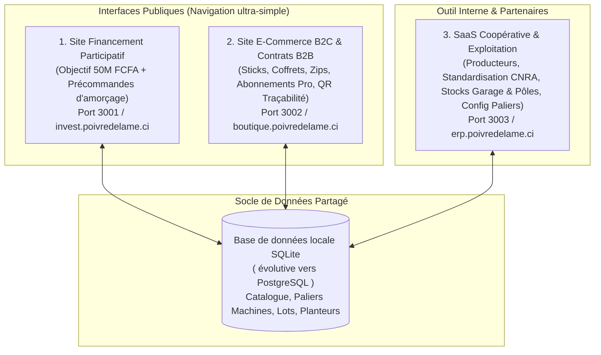

# Plan d'Architecture & Feuille de Route : Écosystème « Poivre de la Mé / Soppi »

Ce plan traduit votre vision d'un découpage clair en **3 applications distinctes** (2 sites web publics à navigation épurée + 1 SaaS métier privé), tout en gérant l'absence actuelle de devis définitifs sur les machines grâce à un **système de budgets et paliers 100 % paramétrables**.

---

## 1. Architecture Globale : 3 Produits Indépendants, 1 Socle de Données Commun

Pour éviter toute lourdeur de navigation pour l'internaute et garder un code simple à maintenir, l'écosystème est séparé en **3 applications autonomes** organisées dans un dossier structuré (`apps/`) qui partagent uniquement une base de données légère commune (`packages/database`).

> [!TIP]
> **Pourquoi ce découpage est idéal :**
> - **Un visiteur sur la page de Financement Participatif (`App 1`)** a un seul objectif : comprendre le projet, voir la crédibilité (certificat GlobalG.A.P., guide CNRA/FIRCA, équipe) et contribuer ou précommander.
> - **Un acheteur ou restaurateur sur la Boutique (`App 2`)** achète ses sticks, ses coffrets Ramadan/Fêtes ou signe un contrat d'approvisionnement annuel B2B sans être distrait par la levée de fonds.
> - **Vous et Mme Soppi sur le SaaS (`App 3`)** gérez l'exploitation quotidienne et mettez à jour les prix des machines dès que vous recevez un devis.

---

## 2. Choix de la Stack Technique (Adaptée à votre environnement Linux / Node v22)

J'ai vérifié votre environnement (`Node.js v22.12.0` installé). Voici la stack la plus productive, robuste et sans frais d'infrastructure pour démarrer :

| Couche | Technologie choisie | Pourquoi ce choix pour cette phase ? |
| :--- | :--- | :--- |
| **Structure projet** | **Monorepo NPM Workspaces** (`apps/crowdfunding`, `apps/ecommerce`, `apps/saas`) | Permet de développer et lancer chaque application séparément tout en partageant les modèles de données. |
| **Framework Web** | **Next.js (App Router) + TypeScript** | Très rapide, excellent référencement (SEO) pour les 2 sites publics, et parfait pour créer un tableau de bord SaaS réactif. |
| **Design & UI** | **Tailwind CSS + Lucide Icons** | Design haut de gamme (« Terroir de luxe ivoirien » : vert forêt, or/ambre, noir poivre, blanc crème), 100 % adapté aux mobiles (WhatsApp/Mobile Money). |
| **Base de données** | **SQLite + Prisma ORM** | **Zéro configuration serveur** au démarrage (un simple fichier local), ultra-rapide, et basculable vers PostgreSQL (Supabase/Neon/VPS) en changeant une seule ligne lors de la mise en production. |

---

## 3. Détail Fonctionnel des 3 Applications

### Produit 1 : Vitrine d'Appel à Financement Participatif + Précommandes (`apps/crowdfunding`)
Conçue comme une **Landing Page de haute conversion** autour de l'objectif de **50 Millions FCFA** ([notes.txt](file:///home/nihongo/Bureau/CLIENTS/___SaaS/mmeSoppiPoivre___SaaS/notes.txt)) :
1. **Hero & Storytelling** : Présentation de *Plantation Soppi / Coopérative SCPPE*, passage intelligent à l'échelle (démarrage immédiat dans l'atelier pilote pour sécuriser la collecte et le conditionnement avant l'usine).
2. **Preuves de confiance (Social Proof)** :
   - Certificat **GLOBALG.A.P. (Ecocert)** et attestation de plantation (10 ha à Brofodoumé).
   - Co-auteur/contributeur du guide officiel **CNRA / FIRCA** ([Document.pdf](file:///home/nihongo/Bureau/CLIENTS/___SaaS/mmeSoppiPoivre___SaaS/Document.pdf)).
   - Réseau actif de **25 à 40 planteurs partenaires**.
3. **Jauge & Paliers d'Investissement Dynamiques (Solution au prix inconnu des machines)** :
   - Tant que vous n'avez pas les devis exacts de chaque machine, la page présente la répartition par **Pôles d'Investissement Prioritaires** (avec montants estimatifs ou pourcentages modifiables à tout moment depuis le SaaS) :
     - **Pôle 1 — Unité Pilote de Conditionnement & Mouture (Priorité 1)** : Aménagement de l'atelier pilote (garage), Tamis calibreur multi-étages, Moulin inox (Poivre & Curcuma), Ensacheuse de **Sticks hermétiques**, Scelleuse de sachets **Zips double-hermétiques**, Remplisseuse bouteilles (plastique & verre luxe).
     - **Pôle 2 — Fonds de Roulement (BFR) Collecte Coopérative** : Rachat garanti du poivre séché standardisé auprès des 25-40 agriculteurs.
     - **Pôle 3 — Équipement Amont & Pôles Partenaires ("Zone brouillon" / Étape 2)** : Atomiseurs (traitement), fûts en aluminium à vannes (lavage/rouissage poivre blanc), égrainage, vannage/triage et séchoirs.
4. **3 Modes de Participation (Simulateur + Tunnel d'engagement)** :
   - **Précommande Solidaire (B2C)** : Coffrets cadeaux 3 poivres (Noir, Blanc, Rouge), packs découverte Sticks Poivre & Poivre-Curcuma.
   - **Préachat Professionnel (B2B)** : Réservation de stock à tarif préférentiel pour maquis, restaurants, hôtels, revendeurs.
   - **Investissement / Prêt Participatif** : Manifestation d'intérêt qualifiée (montant, profil diaspora/local, prise de rendez-vous WhatsApp/contrat).

---

### Produit 2 : Boutique E-Commerce B2C & Portail Contrats B2B (`apps/ecommerce`)
Un site purement commercial pour **écouler le stock** sur Internet et signer des **contrats durables** :
1. **Catalogue B2C Segmenté** :
   - **Gamme "Sticks Hermétiques Usage Unique"** : *Stick Poivre Pur* (positionnement table & vitalité/aphrodisiaque) et *Stick Duo Curcuma + Poivre Noir* (antioxydant activé à 90 %).
   - **Gamme "Ménage & Famille"** : Sachets Zips scellés double-hermétiques, Pots 100g et 200g (Grains ou Moulu : lisse, concassé, extra-fin).
   - **Gamme "Prestige & Cadeaux"** : Bouteilles en verre et Coffrets 3 Poivres (Noir, Blanc, Rouge) avec offre spéciale **Paniers Ramadan, Pâques & Fêtes d'entreprise**.
2. **Espace Contrats B2B & Expansion Sous-Régionale** :
   - Configurateur de **Contrat d'Approvisionnement Récurrent** (hebdomadaire/mensuel/annuel) pour supermarchés, restaurants, maquis, hôtels et grossistes CEDEAO.
   - Génération automatique d'une **Demande de Contrat / Lettre d'Intention (LOI)** téléchargeable en PDF (qui servira aussi de preuve bancaire pour vos futurs dossiers financiers !).
3. **Vérificateur Public de Traçabilité (Scan QR Code)** :
   - Une page dédiée (`/trace/[code-lot]`) permettant à tout acheteur de vérifier l'origine (Brofodoumé, Azaguié, Yakassé Mé...), le taux d'humidité certifié (12-13 %) et la variété (*Muntok* ou *Lampong*).

---

### Produit 3 : Le SaaS Métier Coopérative & Standardisation (`apps/saas`)
Votre tour de contrôle interne pour piloter vos 3 objectifs opérationnels :
1. **Module Producteurs & Formation Standardisée (les 25-40 partenaires + nouveaux)** :
   - Répertoire des planteurs (localisation, variété *Muntok/Lampong*, nombre d'hectares, statut de formation).
   - **Checklist de Standardisation CNRA/FIRCA** ([Document.pdf](file:///home/nihongo/Bureau/CLIENTS/___SaaS/mmeSoppiPoivre___SaaS/Document.pdf)) : suivi par planteur des étapes critiques (pépinière sous ombrière, tuteurs *Glyricidia*, traitements phytosanitaires, récolte au sécateur, ébouillantage 3 min ou rouissage 10 jours, séchage à 12-13 %).
2. **Module Réception, Contrôle Qualité & Rachat de Stock** :
   - Enregistrement des lots collectés auprès des partenaires avec test qualité (Humidité %, Calibre, Propreté) -> attribution automatique du Grade et du prix de rachat.
3. **Module Lieux de Stockage, de Traitement & Parc Machines** :
   - Cartographie de vos sites : **Atelier Central (Garage Mme Soppi)** + **Lieux Partenaires (Stockage/Traitement décentralisé)**.
   - Suivi des stocks par état : *Brut séché* -> *Calibré* -> *Moulu* -> *Conditionné (Sticks / Zips / Pots / Coffrets)*, avec alerte sur le conditionnement double-hermétique.
   - **Gestionnaire des Devis Machines & Paliers 50M FCFA** : interface où vous pourrez saisir ou modifier à tout moment les prix des machines (broyeur, stickeuse, tamis, atomiseurs...) pour mettre à jour instantanément le site de Financement Participatif.

---

## 4. Ordre de Développement Proposé

1. **Étape 1 : Initialisation du Socle & Base de Données (`packages/database`)**
   - Modélisation des produits (Sticks, Zips, Pots, Coffrets), des paliers/machines des 50M FCFA (avec coûts estimatifs éditables), des producteurs (25-40) et des sites de stockage/traitement.
2. **Étape 2 : Développement de l'`App 1` — Vitrine de Financement Participatif (50M FCFA) & Précommandes**
   - Pour vous donner immédiatement un support visuel convaincant à montrer à Mme Soppi et aux premiers contributeurs.
3. **Étape 3 : Développement de l'`App 3` — Le SaaS Métier (Producteurs, Standardisation, Stocks & Configurateur des prix machines)**
   - Connecté en direct à l'`App 1` pour modifier les coûts des machines et suivre les stocks.
4. **Étape 4 : Développement de l'`App 2` — Boutique E-Commerce B2C / Portail Contrats B2B & Traçabilité QR**
   - Pour écouler le stock en ligne et générer les contrats B2B durables.
